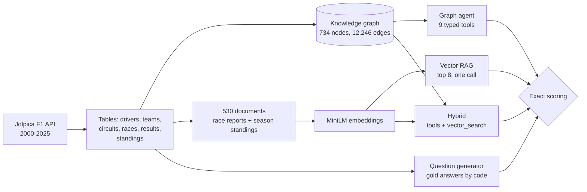

# Graph RAG vs. Vector RAG on 26 Seasons of Formula 1

**When does a knowledge graph beat vector search for question answering over structured data? Measured on 160 Formula 1 questions whose answers are computable from the data, broken down by how many facts each question chains together.**

**[Explore every question and trace →](https://dojedaro.github.io/f1-graphrag/)**

[](https://github.com/dojedaro/f1-graphrag/actions/workflows/ci.yml)

## Results

Same model for every system (Claude Haiku 5.5), same data, exact scoring:

| Question type | Example | Vector RAG | Graph agent | Hybrid |
|---|---|---|---|---|
| 1-hop (36) | Who won the 2009 German Grand Prix? | 97% | 100% | 100% |
| 2-hop (36) | Who was Fisichella's teammate for the whole 2004 season? | 58% | 100% | 100% |
| 3-hop (24) | How many races did the team that won the 2010 Monaco GP win the next season? | 58% | 100% | 100% |
| Aggregation (24) | How many Grands Prix did Räikkönen win driving for Lotus? | **8%** | 100% | 100% |
| **Held-out (40)** | In how many 2016 races did the pole-sitter win? | **40%** | **100%** | **100%** |
| **All 160** | | **88 (55%)** | **160 (100%)** | **160 (100%)** |

| | Vector RAG | Graph agent | Hybrid |
|---|---|---|---|
| Tool calls per question | 0 | 3.3 | 3.6 |
| Seconds per question | 3.4 | 4.5 | 4.6 |
| Total cost, 160 questions | $0.10 | $0.14 | $0.15 |

**What the numbers say:**

- **Vector search is fine for single facts and collapses on counting.** It gets 97% of "who won race X",
  because one retrieved race report holds the answer. It gets 8% of counting questions ("how many races
  did X win for team Y"), because the answer is spread across many race reports and the 8 most similar
  ones are not the complete set. Counting needs completeness, which similarity search doesn't promise.
- **The graph agent wins by computing instead of reading.** For "pole-to-win conversions in 2016" it
  called `race_result` for all 21 races and counted. It even noticed that in two races the pole-sitter
  finished outside the top 10 and reasoned that he therefore couldn't have won.
- **Adding vector search to the graph agent changed nothing here**, for 10% more cost. The graph covers
  everything these questions ask; the hybrid would matter for unstructured questions (race narratives,
  driver quotes) that this data doesn't contain.

### The catch, and how I tested it

I designed the graph tools alongside the first 10 question templates, so some questions map onto one
tool call (`teammates(driver, season)` answers "who was X's teammate"). A perfect score there partly
measures how well the tools fit the questions. To test the tool *design*, I wrote **5 more question
types after the tools existed** (distinct winners in a season, pole-to-win conversions, most wins at a
circuit, podiums without a win, and the runner-up's team). No single tool answers any of them.

The graph agent still scored 40/40, but needed **6 tool calls per question instead of 2.3**: it composed
the general tools. Vector search scored 16/40, and all 8 runner-up questions were among them: those are
the only held-out questions answered inside a single document (the season standings).

**The vector baseline is deliberately standard, not tuned:** top-8 retrieval with a small embedding model
(MiniLM), race documents that list only the top 10 finishers, and a single model call. Stronger variants
(more documents, BM25 or reranking, a retrieval loop) would close part of the gap on lookups; counting
across seasons needs the complete set of records, which is the structural reason a graph or a database
wins there. These are structured, computable questions, the home ground for a graph.

**Limits:** one model, one run per question, 8–12 questions per type, so a 100% score has a 95%
confidence interval reaching down to about 70–90% per type. And 100% on structured questions about one
clean dataset is an upper bound: real questions arrive misspelled, ambiguous and about things the schema
didn't anticipate.

## How it works



**The graph:** Driver, Constructor, Race, Circuit and Season nodes. `RACED` edges carry finishing
position, points, grid slot and status; `DROVE_FOR` edges are keyed by season; seasons point to their
champions.

**The tools are the design that matters.** Nine typed functions an analyst would ask for:
`find_entity`, `driver_career`, `teammates`, `driver_wins`, `season_summary`, `race_result`,
`team_season`, `circuit_history` and `champions`. Each returns names, never bare IDs, and reports
ambiguity instead of guessing: "Schumacher" returns Michael, Ralf and Mick, and the agent has to choose.
Tool schemas use `strict: true`, so arguments always match.

**The benchmark needs no labels.** Every gold answer is computed by code from the same tables the systems
read. Answers are scored by resolving names to entities ("Hamilton" and "Lewis Hamilton" both match;
an ambiguous "Schumacher" does not), and numbers must match exactly. A test checks that every gold
answer passes its own scorer.

## Run it

```bash
pip install -e ".[dev]"
pytest                                    # offline: graph facts, tools, generator, scorer

python -m f1rag.fetch 2000 2025          # refetch the data (already cached in data/raw)
echo ANTHROPIC_API_KEY=... > .env
python -m f1rag.evaluate run --out runs/my-run                 # main set (120 questions)
python -m f1rag.evaluate run --heldout --per-template 8 --out runs/my-heldout
python -m f1rag.site runs/my-run site/data/bundle.json runs/my-heldout   # rebuild the site data
```

`F1RAG_MODEL` switches the model (for example `claude-opus-5-5`); the whole evaluation costs about
$0.40 on Haiku 5.5. The site in `site/` is static and replays the saved runs in `runs/`.

## Stack

Python, NetworkX, sentence-transformers (all-MiniLM-L6-v2), the Anthropic SDK (Claude tool use with
strict schemas), NumPy, pytest, a static site (plain JavaScript and SVG) on GitHub Pages.

## Next steps

- Free-text questions written by people, with typos and vague references, to measure entity resolution
  under realistic input.
- Unstructured sources (race reports, interviews) where the hybrid should earn its cost.
- A larger model sweep, and text-to-Cypher on a graph database as a fourth system: generated queries
  instead of hand-designed tools.

## Data

Formula 1 data from the [Jolpica F1 API](https://github.com/jolpica/jolpica-f1) (the open successor to
Ergast), free for non-commercial use. Raw responses are cached in `data/raw/`.

## License

MIT (code). The data keeps its source's terms.
